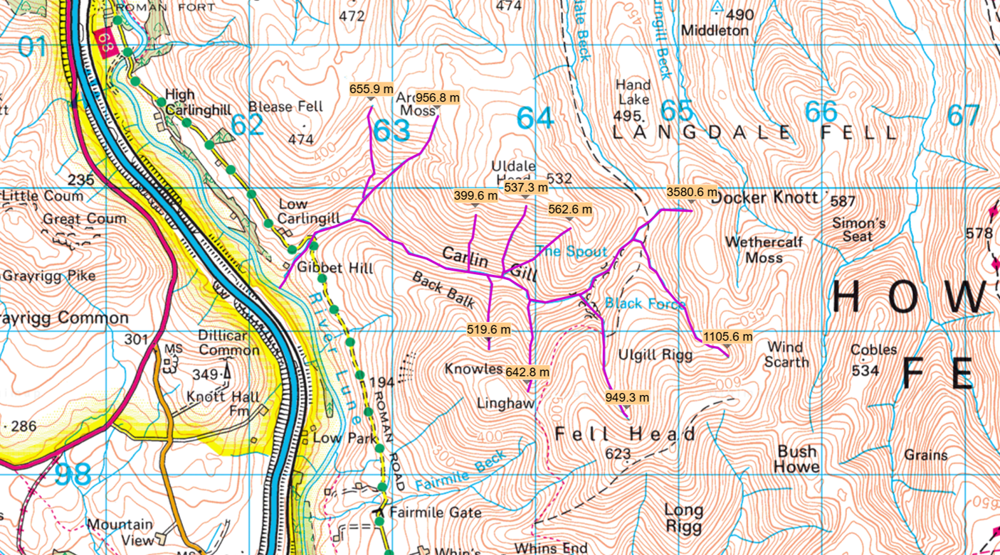
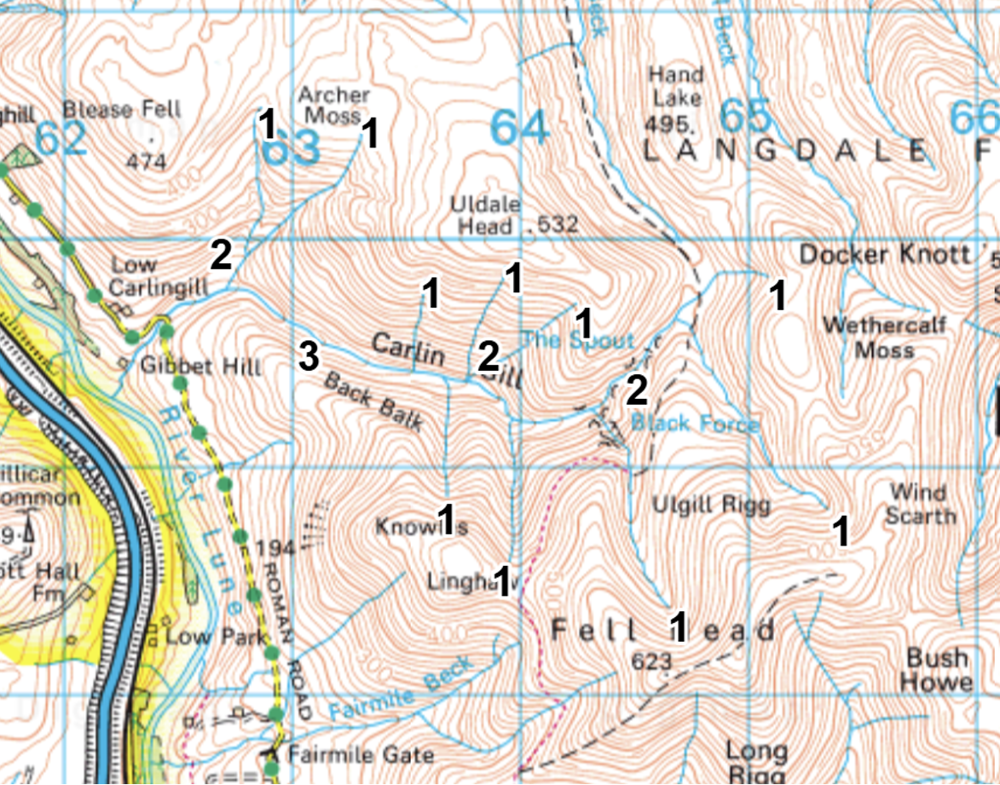
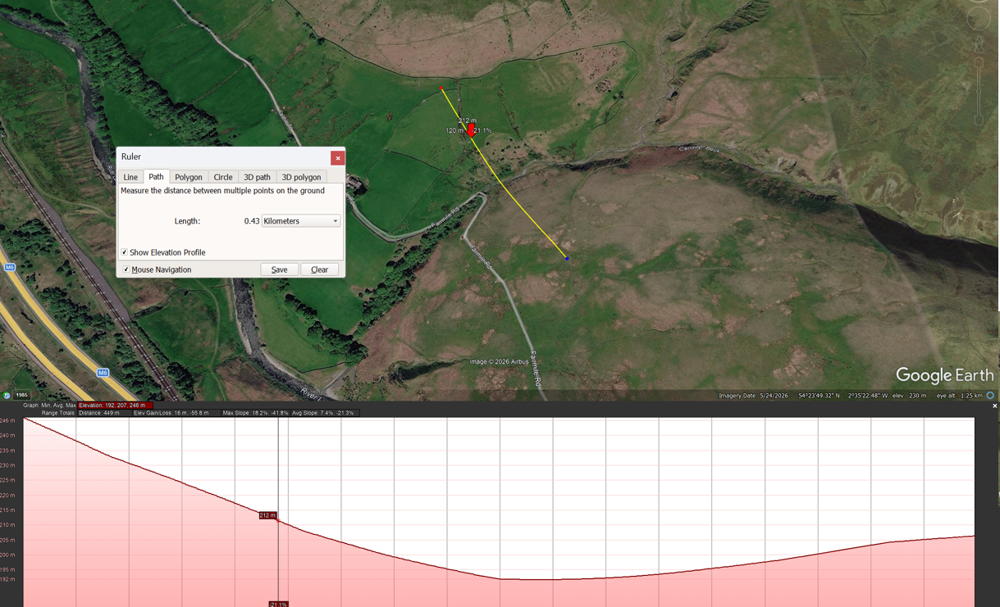
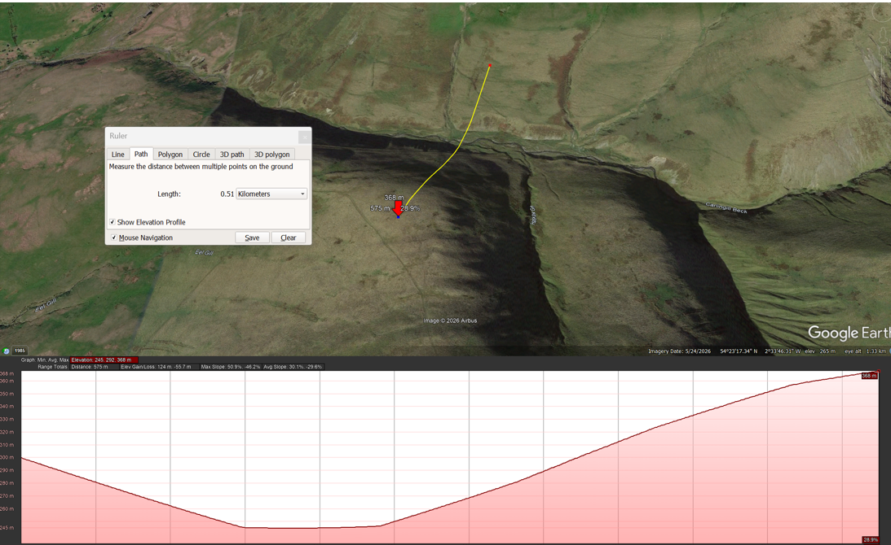
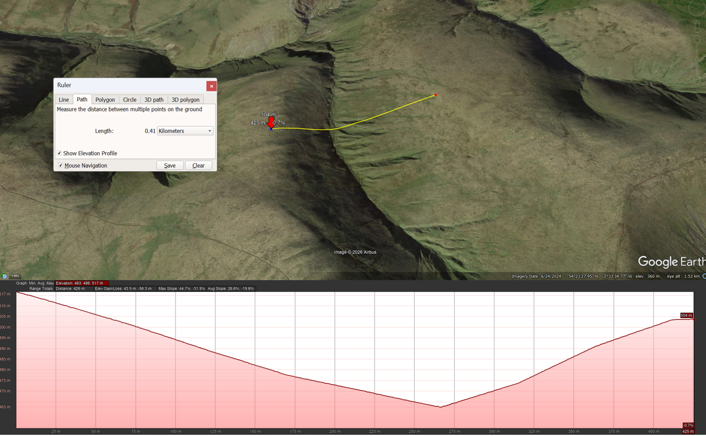

# river-catchment-project
An in depth evaluation of the Carlingill river catchment 
# Measurments of the Carlingill river catchment using Digimap
- Perimeter = 10.8km
- Area = 4.66km2
- Distance = 3655.1m

- Rf (elongation ratio) = 0.35
- Rh (relief ratio) = 0.13
- An elongation ratio of 0.35 shows that the catchment has a elongated shape. A relief ratio of 0.13 shows that the catchment has a shallow gradient, indicating longer lag times in terms of surface run off with lower potential flow velocity.
# Stream length

Stream length total = 9910.1m
Drainage density = 2.15km - indicating it is course 
# Stream order at 500m scale

# Bifurcation ratio
Stream order allows the calculation of a Bifurcation ratio

|Order|Count|Bifurcation Ratio|
|---|---|---|
|  1  |  10 |                 |
|     |  /  |      3.33       |
|  2  |  3  |                 |
|     |  /  |        3        |
|  3  |  1  |                 |

The bifurcation ratio shows to be just above 3. This is considered a low ratio which means the streams branch in a simple and even way. In terms of flood risk, it may be decreased as water is slowly transported to the pain river through these streams rather than all at once. This is also influenced by the gentle releif ratio and the catchment's elongated shape, allowing slow drainage and decreasing flood risk. 
The catchment also has a course drainage texture, measuring at 1.29. This further decreases chances of flooding due to fewer streams in the area, increasing drainage as well as bringing permeable land, decreasing surface runoff. 
# Long profile

The profile does not show much variation form a “textbook" profile curve. Despite small and more sudden changes in gradient (most prominent between 1.25km and 1.7km) which could suggest changes in terrain, the profile shows a smooth elevation gain, implying gentle slopes with some slightly steeper than others. 
# Valley profile

