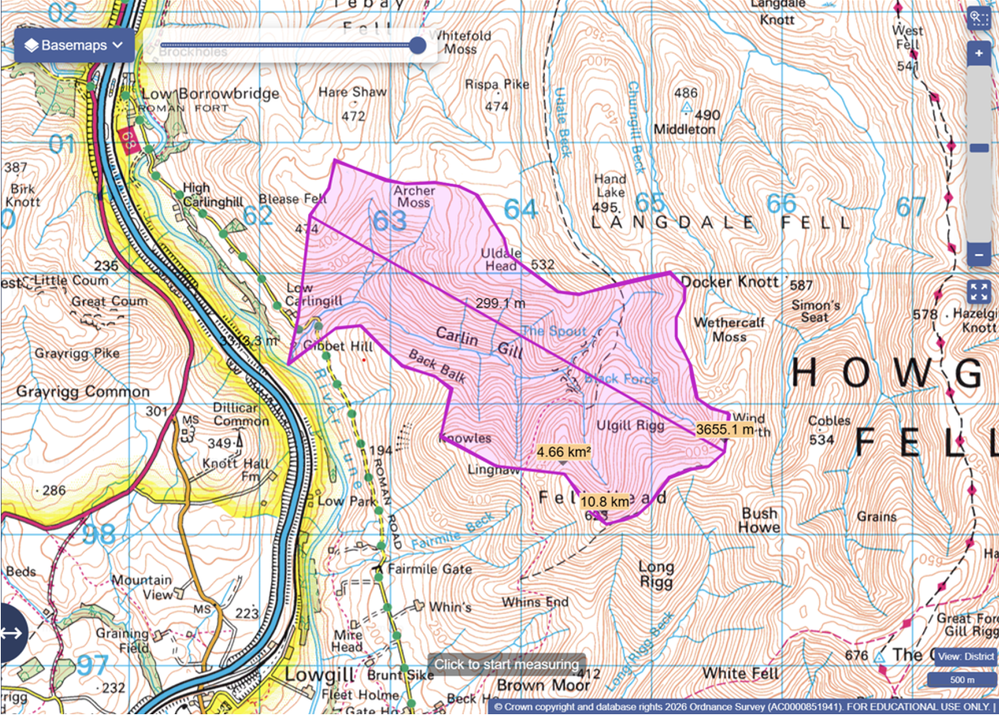

# river-catchment-project
An in depth evaluation of the Carlingill river catchment 
# Measurments of the Carlingill river catchment using Digimap
- Perimeter = 10.8km
- Area = 4.66km2
- Distance = 3655.1m
- Rf (elongation ratio) = 0.35
- Rh (relief ratio) = 0.13
- 
- 
